# Pràctica: Gestió d'usuaris i grups a Linux

|                |                                                   |
|----------------|---------------------------------------------------|
| **Alumne/a**   | Toni Correa                                       |
| **Cicle**      | CFGM Sistemes Microinformàtics i Xarxes – 2n curs |
| **Mòdul**      | Sistemes Operatius                                |
| **Màquina**    | Linux (hostname `sox-tcm`)                        |
| **Data**       | 16 d'octubre de 2026                              |

---

## Índex

1. [Tasca 1 – Grups](#tasca-1--grups)
2. [Tasca 2 – /etc/skel i adduser.conf](#tasca-2--etcskel-i-adduserconf)
3. [Tasca 3 – Usuaris](#tasca-3--usuaris)
4. [Tasca 4 – Inspecció](#tasca-4--inspecció)
5. [Tasca 5 – Bloqueig i eliminació](#tasca-5--bloqueig-i-eliminació)
6. [Tasca 6 – Shell fish](#tasca-6--shell-fish)
7. [Conclusió final](#conclusió-final)

---

## Tasca 1 – Grups

### 1.1 Creació dels grups devs, sysadmin i auditor

**Objectiu de l'acció**
Crear els tres grups que farem servir per organitzar els usuaris segons la seva feina: desenvolupadors, administradors de sistemes i auditors.

**Comanda utilitzada**

```bash
sudo groupadd devs
sudo groupadd sysadmin
sudo groupadd auditor
tail -n 5 /etc/group
```

**Explicació del funcionament**
`groupadd` crea un grup nou i l'afegeix als fitxers `/etc/group` i `/etc/gshadow`. Com que no hem indicat cap GID, el sistema assigna el primer lliure a partir de 1000. Cada línia de `/etc/group` té el format `nom:x:GID:membres`. Amb `tail -n 5` mostrem les cinc últimes línies del fitxer, que és on queden els grups acabats de crear.

**[Captura 1]**

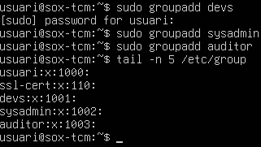

**Comprovació**
Els tres grups apareixen a `/etc/group` amb GID consecutius: `devs` (1001), `sysadmin` (1002) i `auditor` (1003). De moment no tenen cap membre (l'últim camp és buit).

---

## Tasca 2 – /etc/skel i adduser.conf

### 2.1 Fitxer de benvinguda i carpeta Documents a /etc/skel

**Objectiu de l'acció**
Fer que tots els usuaris nous rebin automàticament un fitxer de benvinguda i una carpeta `Documents` a la seva carpeta personal.

**Comanda utilitzada**

```bash
sudo nano /etc/skel/benvinguda.txt
sudo mkdir /etc/skel/Documents
cat /etc/skel/benvinguda.txt
ls -la /etc/skel
```

**Explicació del funcionament**
`/etc/skel` és el directori "esquelet". Quan es crea un usuari amb carpeta personal (amb `adduser` o amb `useradd -m`), el sistema copia tot el contingut d'aquest directori a la nova home, incloent-hi els fitxers ocults com `.bashrc`, `.profile` o `.bash_logout`. Per tant, tot el que hi posem aquí ho tindran tots els usuaris nous.

**[Captura 2]** – Contingut del fitxer de benvinguda

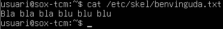

**[Captura 3]** – Contingut de /etc/skel

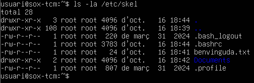

**Comprovació**
A `/etc/skel` hi ha el fitxer `benvinguda.txt` i la carpeta `Documents`, juntament amb els fitxers ocults per defecte. Ara són propietat de `root`; quan es copiïn a un usuari nou passaran a ser seus.

### 2.2 Alias `ll` al .bashrc de /etc/skel

**Objectiu de l'acció**
Que tots els usuaris nous tinguin l'alias `ll` per llistar fitxers en format llarg, amb ocults i amb colors.

**Configuració utilitzada**

```bash
sudo nano /etc/skel/.bashrc
```

Dins el fitxer, a la secció `# some more ls aliases`, he deixat la línia així:

```bash
alias ll='ls -la --color=auto'
```

**Explicació del funcionament**
El `.bashrc` s'executa cada vegada que l'usuari obre una shell bash interactiva. Un `alias` és una drecera: quan escrivim `ll`, bash l'executa com si haguéssim escrit `ls -la --color=auto`. El fitxer ja portava un alias `ll` per defecte (`ls -alF`) i l'he modificat. Com que el canvi està al `.bashrc` de `/etc/skel`, només afecta els usuaris que es creïn a partir d'ara.

**[Captura 4]**

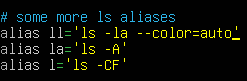

**Comprovació**
La línia de l'alias apareix modificada al fitxer. Comprovo que funciona a l'apartat 2.4.

### 2.3 Shell per defecte a /etc/adduser.conf

**Objectiu de l'acció**
Comprovar que els usuaris creats amb `adduser` tinguin `/bin/bash` com a shell per defecte.

**Comanda utilitzada**

```bash
grep DSHELL /etc/adduser.conf
```

**Explicació del funcionament**
`/etc/adduser.conf` és el fitxer de configuració de la comanda `adduser`. La variable `DSHELL` indica la shell d'inici de sessió que s'assigna als usuaris nous. Al fitxer surt la línia `# Default: DSHELL=/bin/bash`, que vol dir que el valor per defecte ja és `/bin/bash`. Per això la línia `#DSHELL=/bin/bash` pot estar comentada i funciona igual. Si volguéssim una altra shell, hauríem de treure el `#` i canviar el valor.

**[Captura 5]**

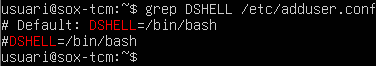

**Comprovació**
La shell per defecte és `/bin/bash`. Es confirma més endavant a `/etc/passwd`, on `pau_dev` (creat amb `adduser`) té `/bin/bash` (Captura 11).

### 2.4 Prova amb l'usuari prova07

**Objectiu de l'acció**
Crear un usuari de prova per verificar que es copien els fitxers de `/etc/skel` i que l'alias `ll` funciona.

**Comanda utilitzada**

```bash
sudo adduser prova07
su - prova07
ls -la
ll
```

**Explicació del funcionament**
`adduser` és una comanda interactiva de Debian/Ubuntu que, en un sol pas, crea l'usuari i un grup amb el mateix nom, crea la carpeta personal, hi copia `/etc/skel` (missatge `Copying files from '/etc/skel'`), demana la contrasenya i les dades personals (camp GECOS). També l'afegeix al grup secundari `users`. Amb `su - prova07` iniciem una sessió completa com aquest usuari, així es carrega el seu `.bashrc`.

**[Captura 6]**

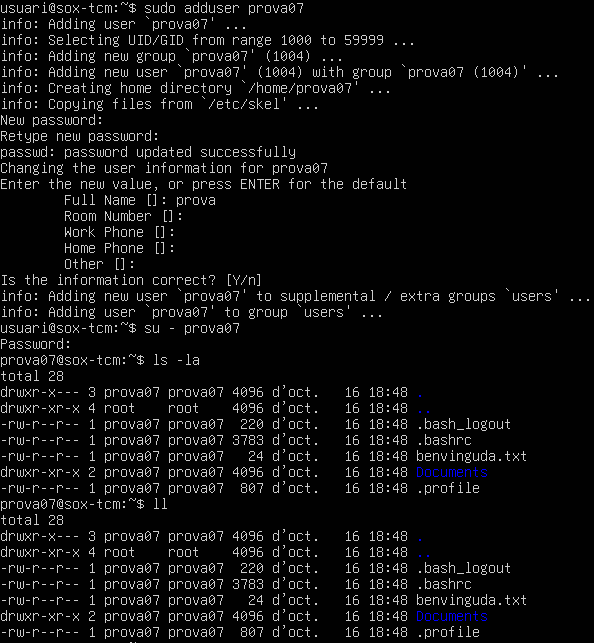

**Comprovació**
L'usuari s'ha creat amb UID/GID 1004. A la seva home hi ha `benvinguda.txt` i `Documents`, ara com a propietat de `prova07`. La comanda `ll` dona el mateix resultat que `ls -la`, per tant l'alias s'ha copiat i funciona.

### 2.5 Eliminació de l'usuari de prova

**Objectiu de l'acció**
Esborrar l'usuari `prova07` i la seva carpeta personal, ja que només servia per fer la prova.

**Comanda utilitzada**

```bash
sudo deluser --remove-home prova07
```

**Explicació del funcionament**
`deluser` és la comanda de Debian/Ubuntu per eliminar usuaris (la parella d'`adduser`). L'opció `--remove-home` esborra també la carpeta personal i la bústia de correu. És l'equivalent a l'opció `-r` de `userdel`, que és la que demana l'enunciat.

**[Captura 7]**

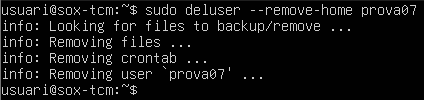

**Comprovació**
La sortida mostra que s'han esborrat els fitxers, el crontab i finalment l'usuari (`Removing user 'prova07'`), sense cap error.

---

## Tasca 3 – Usuaris

### 3.1 Creació de pau_dev i laura_dev amb adduser

**Objectiu de l'acció**
Crear els dos desenvolupadors amb `devs` com a grup principal.

**Comanda utilitzada**

```bash
sudo adduser --ingroup devs pau_dev
sudo adduser --ingroup devs laura_dev
```

**Explicació del funcionament**
L'opció `--ingroup devs` fa que el grup principal de l'usuari sigui `devs`, en lloc de crear un grup personal amb el seu nom. La resta del procés és el mateix que a l'apartat 2.4: es crea la home, es copia `/etc/skel` i es demana la contrasenya.

**[Captura 8-1]**

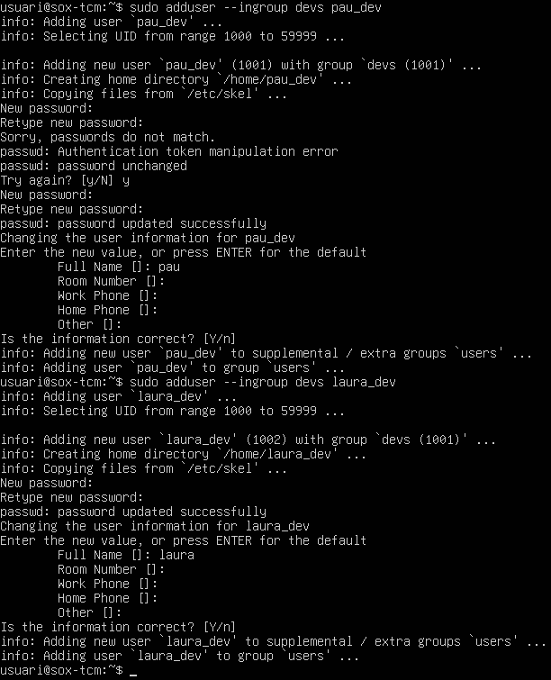

**Comprovació**
`pau_dev` té UID 1001 i `laura_dev` UID 1002, i tots dos tenen el grup `devs (1001)`. Amb `pau_dev` les dues contrasenyes no coincidien la primera vegada i el sistema ha tornat a demanar-la.

### 3.2 Creació de marc_sys i auditor amb useradd

**Objectiu de l'acció**
Crear l'administrador `marc_sys` (grup principal `sysadmin` i secundari `devs`) i l'usuari `auditor`, fent servir la comanda de baix nivell `useradd`.

**Comanda utilitzada**

```bash
sudo useradd -m -d /home/marc_sys -s /bin/bash -g sysadmin -G devs -c "Marc Soler" marc_sys
sudo useradd -m -d /home/auditor -s /bin/bash -g auditor -c "Usuari Auditor" auditor
```

**Explicació del funcionament**
`useradd` no és interactiva i tot s'ha d'indicar amb opcions:

| Opció | Funció |
|-------|--------|
| `-m` | Crea la carpeta personal (i hi copia `/etc/skel`) |
| `-d` | Ruta de la carpeta personal |
| `-s` | Shell d'inici de sessió |
| `-g` | Grup principal |
| `-G` | Grups secundaris |
| `-c` | Comentari (nom complet, camp GECOS) |

A diferència d'`adduser`, no demana contrasenya, així que l'he de posar després.

**[Captura 8-2]**

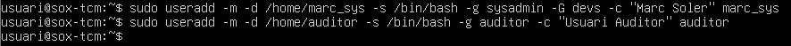

**Comprovació**
Les comandes no mostren cap missatge, cosa que a Linux vol dir que s'han executat correctament. Ho comprovo a la Tasca 4 amb `id marc_sys`.

### 3.3 Contrasenyes i canvi obligatori a pau_dev

**Objectiu de l'acció**
Posar la contrasenya `Canviam2026!` als usuaris i obligar `pau_dev` a canviar-la al primer inici de sessió.

**Comanda utilitzada**

```bash
sudo passwd marc_sys
sudo passwd auditor
sudo chage -d 0 pau_dev
su - pau_dev
```

També es pot fer sense que ho demani per teclat amb `chpasswd`:

```bash
echo 'marc_sys:Canviam2026!' | sudo chpasswd
```

**Explicació del funcionament**
`passwd` canvia la contrasenya d'un usuari i la guarda xifrada a `/etc/shadow`. `pau_dev` i `laura_dev` ja la tenien posada des d'`adduser`. `chage -d 0` posa la data de l'últim canvi de contrasenya a 0 (1 de gener de 1970). Per tant, el sistema considera que la contrasenya ha caducat i obliga l'usuari a canviar-la quan entri.

**[Captura 9]**

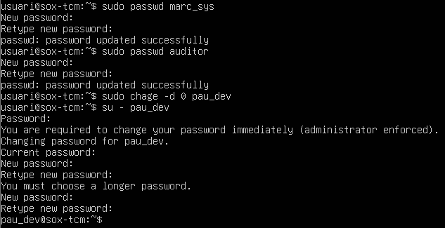

**Comprovació**
En fer `su - pau_dev`, apareix el missatge `You are required to change your password immediately (administrator enforced)` i el sistema demana la contrasenya actual i una de nova. El primer intent es rebutja per ser massa curta (`You must choose a longer password`). Amb una contrasenya vàlida ja s'entra com a `pau_dev`.

---

## Tasca 4 – Inspecció

### 4.1 Grups de marc_sys

**Objectiu de l'acció**
Comprovar que `marc_sys` té el grup principal i el secundari correctes.

**Comanda utilitzada**

```bash
id marc_sys
```

**Explicació del funcionament**
`id` mostra l'UID de l'usuari, el seu GID (grup principal) i la llista de tots els grups als quals pertany.

**[Captura 10]**

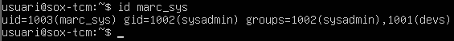

**Comprovació**
`uid=1003(marc_sys)`, `gid=1002(sysadmin)` i `groups=1002(sysadmin),1001(devs)`. Per tant, el grup principal és `sysadmin` i el secundari és `devs`, tal com demanava l'enunciat.

### 4.2 Diferència entre /etc/passwd i /etc/shadow

**Objectiu de l'acció**
Veure com es guarda la informació de `pau_dev` a cada fitxer i entendre per què la contrasenya no és a `/etc/passwd`.

**Comanda utilitzada**

```bash
grep pau_dev /etc/passwd
sudo grep pau_dev /etc/shadow
ls -l /etc/shadow
```

**Explicació del funcionament**
A `/etc/passwd` hi ha la informació bàsica de l'usuari, amb el format `usuari:x:UID:GID:GECOS:home:shell`:

```
pau_dev:x:1001:1001:pau,,,:/home/pau_dev:/bin/bash
```

La `x` del segon camp indica que la contrasenya no és aquí, sinó a `/etc/shadow`. Aquest fitxer té el format `usuari:hash:últim_canvi:mín:màx:avís:inactiu:caducitat:`:

- **Hash**: comença per `$y$`, que vol dir que s'ha xifrat amb l'algorisme *yescrypt*.
- **20742**: dia de l'últim canvi comptat des de l'1/1/1970 (correspon al 16/10/2026, quan `pau_dev` va canviar la contrasenya).
- **0 / 99999 / 7**: dies mínims entre canvis, dies màxims de validesa i dies d'avís abans de caducar.

`/etc/passwd` l'han de poder llegir tots els usuaris, perquè molts programes l'utilitzen per passar d'UID a nom d'usuari. Per això els hashes es van moure a `/etc/shadow`, que té permisos `-rw-r-----` amb propietari `root` i grup `shadow`. Només root el pot modificar i només el grup `shadow` el pot llegir. Així un usuari normal no pot copiar els hashes per intentar trencar-los per força bruta.

**[Captura 11]**

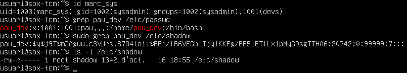

**Comprovació**
A `/etc/passwd` només surt la `x`, mentre que a `/etc/shadow` hi ha el hash i les dades de caducitat. Per llegir `shadow` cal fer servir `sudo`.

### 4.3 Directori esquelet a adduser.conf

**Objectiu de l'acció**
Comprovar quin directori es fa servir com a plantilla per a les carpetes personals.

**Comanda utilitzada**

```bash
grep SKEL /etc/adduser.conf
```

**Explicació del funcionament**
La variable `SKEL` d'`adduser.conf` indica de quin directori es copien els fitxers a la home dels usuaris nous. Igual que amb `DSHELL`, la línia surt comentada, però el valor per defecte (`# Default: SKEL=/etc/skel`) ja és `/etc/skel`. La variable `SKEL_IGNORE_REGEX` indica quins fitxers no s'han de copiar (còpies de seguretat de `dpkg` i `ucf`). La comanda `useradd` no llegeix aquest fitxer: fa servir la variable `SKEL` de `/etc/default/useradd` o l'opció `-k`.

**[Captura 12]**

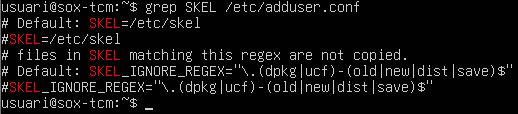

**Comprovació**
El directori esquelet és `/etc/skel`, cosa que coincideix amb el que hem vist a la Tasca 2: els fitxers que hi vam posar s'han copiat als usuaris nous.

---

## Tasca 5 – Bloqueig i eliminació

### 5.1 Bloqueig del compte de pau_dev

**Objectiu de l'acció**
Bloquejar temporalment el compte de `pau_dev` sense esborrar-lo.

**Comanda utilitzada**

```bash
sudo usermod -L pau_dev
sudo grep pau_dev /etc/shadow
```

**Explicació del funcionament**
`usermod -L` (*lock*) posa un `!` davant del hash de la contrasenya a `/etc/shadow`. Així el hash deixa de ser vàlid i cap contrasenya hi coincideix, però l'original no es perd.

**[Captura 13]**

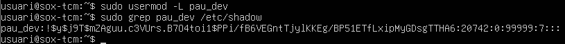

**Comprovació**
El segon camp de `/etc/shadow` ara comença per `!$y$...`, per tant el compte està bloquejat.

### 5.2 Desbloqueig del compte

**Objectiu de l'acció**
Tornar a activar el compte de `pau_dev`.

**Comanda utilitzada**

```bash
sudo usermod -U pau_dev
sudo grep pau_dev /etc/shadow
```

**Explicació del funcionament**
`usermod -U` (*unlock*) treu el `!` de davant del hash, i el hash torna a ser el d'abans.

**[Captura 14]**

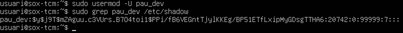

**Comprovació**
El hash torna a començar per `$y$` i és idèntic al de la Captura 11, així que `pau_dev` pot tornar a entrar amb la mateixa contrasenya.

### 5.3 Eliminació de l'usuari auditor

**Objectiu de l'acció**
Eliminar completament l'usuari `auditor` i la seva carpeta personal.

**Comanda utilitzada**

```bash
sudo userdel -r auditor
ls /home/
```

**Explicació del funcionament**
`userdel` esborra l'usuari de `/etc/passwd`, `/etc/shadow` i `/etc/group`. L'opció `-r` també elimina la carpeta personal i la bústia de correu (`/var/mail/auditor`). La primera vegada que la vaig executar va sortir l'avís `mail spool (/var/mail/auditor) not found`. És normal, perquè l'usuari no havia rebut mai cap correu i no tenia bústia, però l'usuari es va esborrar correctament.

**[Captura 15]**

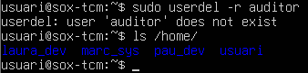

**Comprovació**
A la captura es veu que, en tornar a executar `userdel -r auditor`, surt `user 'auditor' does not exist`, cosa que confirma que l'usuari ja no existeix. A més, a `/home` només hi ha `laura_dev`, `marc_sys`, `pau_dev` i `usuari`, sense la carpeta `auditor`.

---

## Tasca 6 – Shell fish

### 6.1 Instal·lació de fish i canvi de shell a laura_dev

**Objectiu de l'acció**
Instal·lar la shell `fish` i assignar-la com a shell d'inici de sessió de `laura_dev`.

**Comanda utilitzada**

```bash
sudo apt install fish -y
sudo chsh -s /usr/bin/fish laura_dev
grep laura_dev /etc/passwd
```

**Explicació del funcionament**
`apt install fish` instal·la el paquet i afegeix `/usr/bin/fish` al fitxer `/etc/shells`, que és la llista de shells vàlides del sistema. `chsh -s` (*change shell*) canvia l'últim camp de la línia de l'usuari a `/etc/passwd`. Només accepta shells que estiguin a `/etc/shells`.

**[Captura 16]**

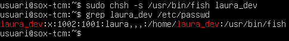

**Comprovació**
La línia de `laura_dev` a `/etc/passwd` acaba amb `/usr/bin/fish` en lloc de `/bin/bash`.

### 6.2 Inici de sessió amb fish

**Objectiu de l'acció**
Comprovar que `laura_dev` entra directament a la shell `fish`.

**Comanda utilitzada**

```bash
su - laura_dev
echo $SHELL
```

**Explicació del funcionament**
En fer `su -` s'inicia una sessió completa amb la shell indicada a `/etc/passwd`. La variable d'entorn `$SHELL` guarda la shell d'inici de sessió de l'usuari actual.

**[Captura 17]**

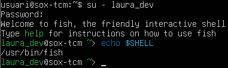

**Comprovació**
Surt el missatge `Welcome to fish, the friendly interactive shell`, el prompt canvia de format (`laura_dev@sox-tcm ~>`) i `echo $SHELL` retorna `/usr/bin/fish`.

---

## Conclusió final

Amb aquesta pràctica he après a gestionar usuaris i grups des de la terminal. He vist la diferència entre `adduser`, que és interactiva i fa gairebé tot sola, i `useradd`, que és de baix nivell i on tot s'ha d'indicar amb opcions. També he vist com preparar l'entorn dels usuaris nous amb `/etc/skel` i `adduser.conf`. He entès per què les contrasenyes es guarden a `/etc/shadow` i no a `/etc/passwd`, i he fet servir eines com `chage`, `usermod -L/-U` i `chsh` per controlar els comptes. Són tasques bàsiques per a qualsevol administrador de sistemes, per exemple per donar d'alta treballadors nous o bloquejar un compte sense perdre'n les dades.
